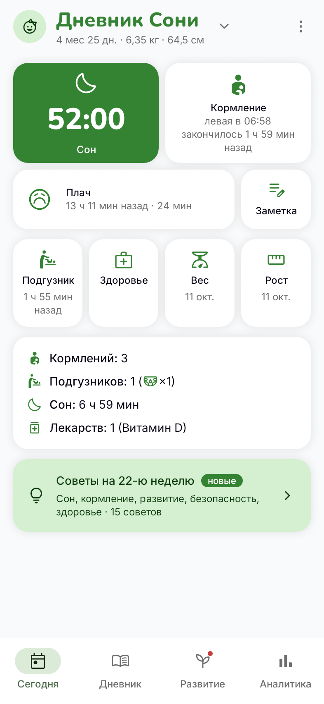
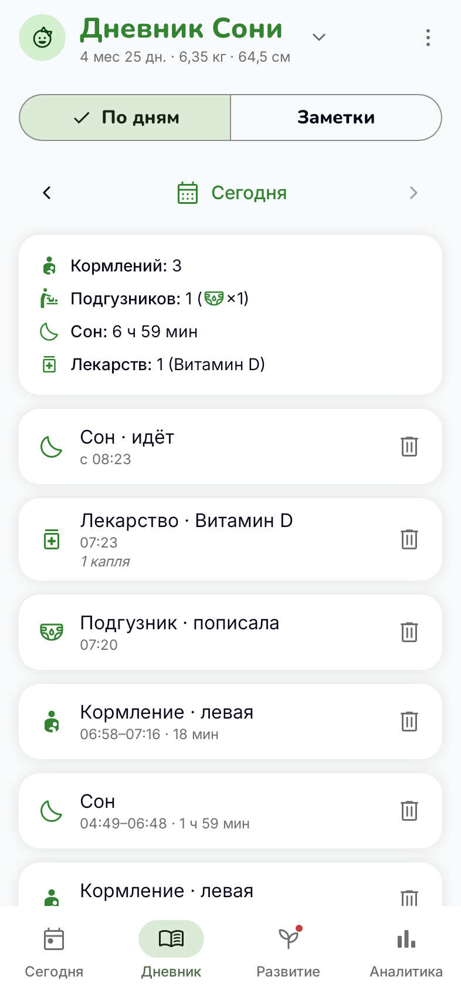
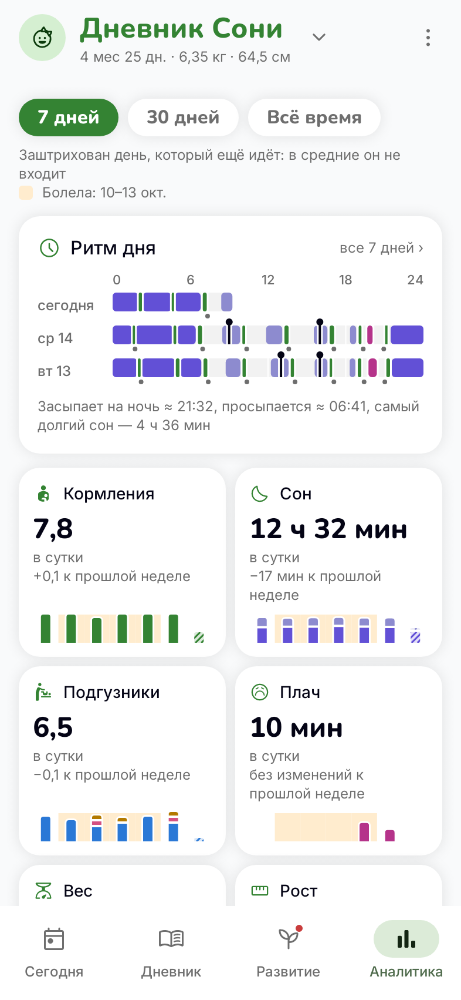
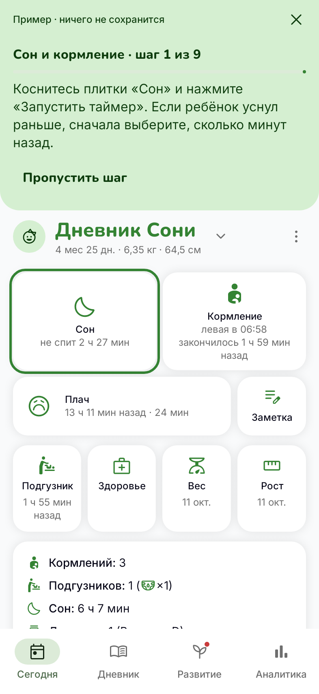
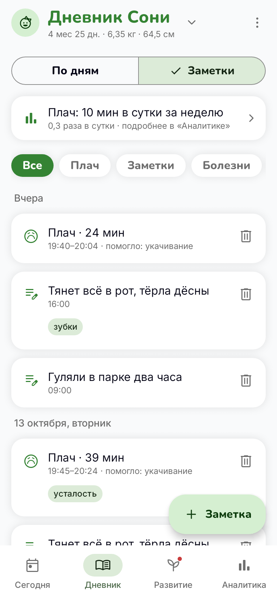
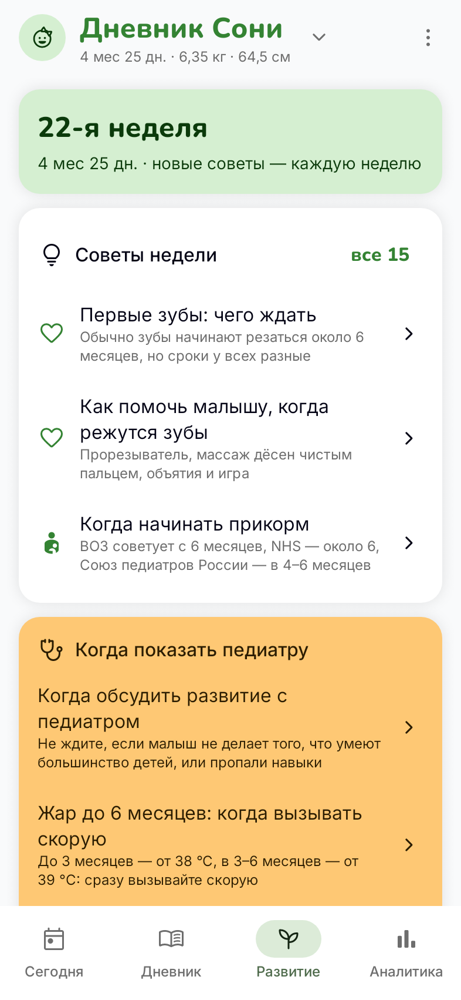
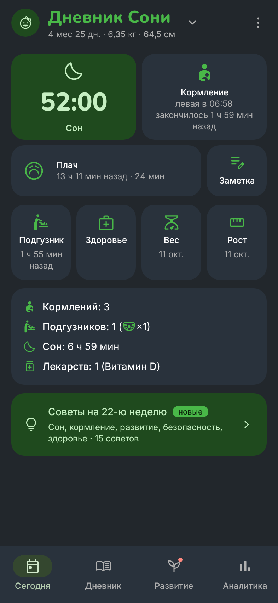

# Дневник малыша

[](https://github.com/hiraise/Babylog/actions/workflows/ci.yml)
[](https://github.com/hiraise/Babylog/releases/latest)
[](#лицензия)

**Открытый дневник режима малыша для Android.** Сон, кормления, подгузники, плач, здоровье,
рост и вес — одной рукой, пока ребёнок на руках. Записи хранятся только на телефоне:
без интернета, аккаунтов, рекламы и подписок.

<p align="center">
  
  
  
  
</p>

<p align="center">
  <a href="https://github.com/hiraise/Babylog/releases/latest"><b>Скачать APK</b></a> ·
  <a href="#что-умеет">Что умеет</a> ·
  <a href="#приватность">Приватность</a> ·
  <a href="docs/development.md">Для разработчиков</a>
</p>

## Что умеет

- ⏱ **Таймеры одним касанием** — сон, кормление и плач: касание плитки запускает и останавливает,
  ⇄ меняет грудь, «Отменить» возвращает остановленный случайно. Таймер переживает перезагрузку телефона.
- 🧷 **Быстрые записи** — подгузник с фото для врача, бутылочка, лекарство с подсказками из прошлых
  записей, вес и рост. Было раньше — «15 минут назад» одним касанием.
- 😢 **Плач и заметки** — почему плакал и что помогло, заметки с метками и фото, сводка по метке:
  когда обычно начинается плач и что было перед ним.
- 🤒 **Болезнь** — температура, лекарства и заметки собираются в одну болезнь по дням,
  а сводку «Для врача» можно отправить.
- 📈 **Аналитика** — сон ночью и днём, кормления, подгузники, плач, вес и рост за неделю, месяц
  или всё время; ритм дня по часам. Всё считается на телефоне.
- 🌱 **Развитие** — советы на каждую неделю жизни и окна навыков по таблицам ВОЗ, у каждого
  совета — источник.
- 👶 **Несколько детей** — у каждого свои записи, таймеры и сводка; фото и возраст — в шапке.
- 🔔 **Кнопки в шторке** — «Сон», «Кормление» и «Плач» в уведомлении, не открывая приложения.
- 📦 **Перенос с фото** — весь дневник одним архивом .zip: записи, фото записей и детей — на новый телефон
  или про запас; импорт добавляет только новое.
- 🌙 **Светлая и тёмная тема** — и пять палитр для тёмной, чтобы не слепить ночью.
- ❓ **Справка с примерами** — каждую тему можно пройти на примере дневника, не трогая свои записи.

<p align="center">
  
  
  
</p>

## Как пользоваться

Приложение само показывает, как им пользоваться: меню ⋮ → **«Справка»**. В ней десять тем —
от таймеров до переноса данных. Каждую можно прочитать или пройти на примере дневника: нажимаете
по-настоящему, а ваши записи не меняются. После обновления новое в справке помечено «Новое»
([ADR-0043](docs/adr/0043-help-guides.md)).

## Приватность

- **Нет доступа в интернет.** У приложения нет разрешения INTERNET — оно физически не может выйти
  в сеть. Разрешений всего два, и оба — для кнопок в шторке, если их включить: показывать
  уведомление и возвращать его после перезагрузки телефона.
- **Записи — только на телефоне.** Нет аккаунтов, своего сервера, аналитики и рекламы. Раз в день
  приложение само копирует дневник на телефоне и восстановит его из копии, если база повредится.
  Автобэкап Android в облако Google отключён.
- **Наружу — только по вашему нажатию.** «Поделиться» отправляет подпись и фото в приложение,
  которое вы выберете; «Экспорт в файл» сохраняет архив с записями и фото туда, куда вы укажете
  ([формат файла](docs/development.md#формат-экспорта)).
- **Перенос на новый телефон** — экспорт в файл и импорт из него (записи вместе с фото) или системный перенос
  Android 12+ «телефон → телефон»: он забирает дневник вместе с фото.

Почему так — [ADR-0002](docs/adr/0002-standalone-local-data.md).

## Интеграции

Пока интеграций нет — приложение полностью офлайн. Каждая будущая интеграция
по умолчанию выключена и описывается здесь отдельным подразделом:

- что она делает;
- какие данные, куда и когда уходят с устройства;
- как включить и настроить (адреса, ключи и токены вводит пользователь, они
  хранятся только на телефоне);
- как отключить и что станет с уже переданными данными.

## Установка на телефон

Готовые APK лежат в [Releases](https://github.com/hiraise/Babylog/releases). Их собирает
и подписывает GitHub Actions из исходников этого репозитория
([ADR-0012](docs/adr/0012-release-signing.md)).

1. Скачайте `babylog-<версия>.apk` на телефон и откройте его, разрешив установку
   из неизвестных источников, **или**
2. по кабелю: включите отладку по USB и выполните `adb install babylog-<версия>.apk`.

Новая версия ставится поверх старой, записи сохраняются.

**Проверка подлинности.** Рядом с APK лежит файл `.sha256` с контрольной суммой.
Отпечаток SHA-256 сертификата подписи
(`apksigner verify --print-certs babylog-<версия>.apk`):

```text
E4:3B:34:E3:22:43:87:44:83:02:68:DE:4B:55:79:CA:FA:E4:6C:4B:54:9A:CE:B0:26:5A:91:0A:4D:77:F3:95
```

**Если стоит версия, собранная до появления релизов** (подписанная debug-ключом),
Android не поставит релиз поверх неё. Перенесите записи один раз: в старой версии ⋮ → «Экспорт в CSV»,
удалите старое приложение, установите новое и загрузите файл: ⋮ → «Импорт из файла».

## Открытый проект

- **Свободный и некоммерческий.** Код открыт под [GPL-3.0-or-later](#лицензия); рекламы, платных
  функций, подписок и закрытых частей нет и не будет ([ADR-0001](docs/adr/0001-open-source-non-commercial.md)).
- **Разрабатывают AI-агенты (Claude)** по правилам из [CLAUDE.md](CLAUDE.md); архитектурные решения —
  в [docs/adr/](docs/adr/README.md).
- **Сборка, отладка, технологии и формат экспорта** — в [docs/development.md](docs/development.md).

## Лицензия

BabyLog — свободное программное обеспечение: его можно распространять и изменять
на условиях GNU General Public License версии 3 либо (по вашему выбору) любой более
поздней версии, опубликованной Free Software Foundation
(`SPDX-License-Identifier: GPL-3.0-or-later`).

Программа распространяется в надежде, что будет полезной, но БЕЗ КАКИХ-ЛИБО
ГАРАНТИЙ, в том числе без подразумеваемых гарантий ТОВАРНОЙ ПРИГОДНОСТИ и
ПРИГОДНОСТИ ДЛЯ КОНКРЕТНОЙ ЦЕЛИ. Полный текст лицензии — в файле [LICENSE](LICENSE).

Тексты советов раздела «Развитие» (`app/src/main/assets/development/`) — тоже
GPL-3.0-or-later. Это пересказ рекомендаций ВОЗ, CDC, AAP, NHS, Минздрава России
и Союза педиатров России; у каждого совета указаны источник и раздел, а окна навыков —
числа из таблицы ВОЗ Motor Development Study ([ADR-0037](docs/adr/0037-development-tips.md)).

Сторонние ресурсы в составе приложения распространяются под своими лицензиями:

- шрифты Inter (© The Inter Project Authors) и Nunito (© The Nunito Project
  Authors) в `app/src/main/res/font/` — SIL Open Font License 1.1, тексты
  лицензий — [OFL-Inter.txt](app/src/main/assets/licenses/OFL-Inter.txt) и
  [OFL-Nunito.txt](app/src/main/assets/licenses/OFL-Nunito.txt);
- иконки Material Symbols (© Google) в `app/src/main/res/drawable/ic_*.xml`,
  кроме `ic_launcher_foreground.xml` и своих иконок проекта `ic_diaper_wet.xml`,
  `ic_diaper_dirty.xml`, `ic_diaper_mixed.xml`, `ic_child_girl.xml`
  ([ADR-0014](docs/adr/0014-own-icons.md)), —
  Apache License 2.0, текст —
  [Apache-2.0-Material-Symbols.txt](app/src/main/assets/licenses/Apache-2.0-Material-Symbols.txt).
